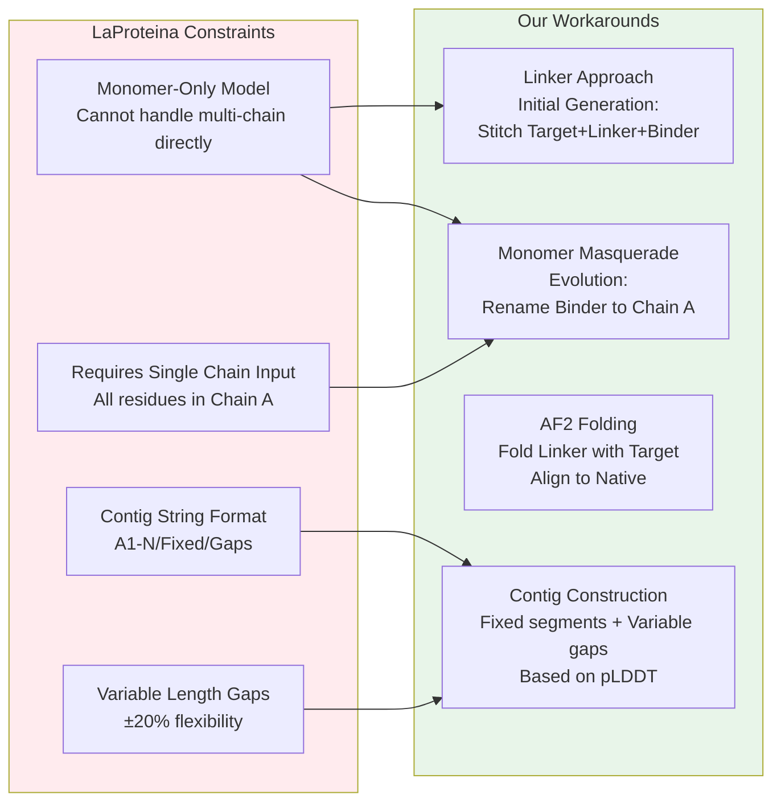
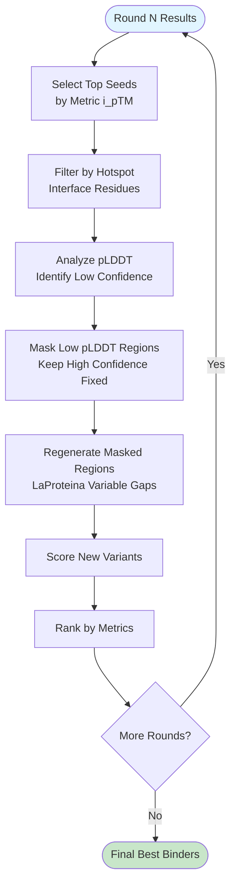

# BindCraft-LaProteina Workflow Diagram

## Complete Workflow Overview

```mermaid
flowchart TD
    Start([Start: Target PDB]) --> InitGen[Initial Generation Phase]
    
    subgraph InitGen["Initial Generation Phase"]
        direction TB
        T1[Load Native Target PDB<br/>Chain A]
        T1 --> L1{Linker Needed?}
        L1 -->|Yes| L2[Build Linker Sequence<br/>GGGGS repeats]
        L2 --> L3[Fold Linker with AF2<br/>Target + Linker]
        L3 --> L4[Align Linker to Native<br/>Kabsch Algorithm]
        L4 --> L5[Stitch: Native Target + Aligned Linker]
        L5 --> LP1[LaProteina Input:<br/>Single Chain Monomer]
        L1 -->|No| LP1
        LP1 --> LP2[Generate Binder<br/>Contig: A1-TargetLen/LinkerLen/BinderRange]
        LP2 --> LP3[LaProteina Output:<br/>Target+Linker+Binder Monomer]
        LP3 --> E1[Extract Binder<br/>Remove Linker<br/>Split Chain B]
    end
    
    InitGen --> Scoring[Scoring Phase]
    
    subgraph Scoring["Scoring Phase"]
        direction TB
        S1[AF2 Complex Prediction<br/>Target + Binder]
        S1 --> S2[PyRosetta Relaxation]
        S2 --> S3[Interface Scoring<br/>dG, dSASA, Shape Complementarity]
        S3 --> S4[Extract Target Interface Residues<br/>PyRosetta NeighborhoodResidueSelector]
        S4 --> S5[Save Metrics to CSV<br/>+ target_interface_residues]
        S5 --> S6{Pass Filters?}
        S6 -->|Yes| Success[Successful Designs]
        S6 -->|No| Failed[Failed Designs]
    end
    
    Scoring --> Decision{Iterative Evolution?}
    
    Decision -->|No| End1([End: Results])
    Decision -->|Yes| Evolve[Evolution Phase]
    
    subgraph Evolve["Iterative Evolution Phase"]
        direction TB
        E2[Select Seeds from CSV<br/>Rank by Metric i_pTM]
        E2 --> E3{Filter by Hotspot?}
        E3 -->|Yes| E4[Check Interface Residues<br/>in Hotspot Regions]
        E4 --> E5{Has Interface<br/>in Hotspot?}
        E5 -->|No| FilterOut[Filter Out Seed]
        E5 -->|Yes| E6[Load Seed PDB<br/>AF2 Prediction]
        E3 -->|No| E6
        E6 --> E7[Monomer Masquerade<br/>Rename Binder to Chain A<br/>Renumber Continuously]
        E7 --> E8[Analyze pLDDT<br/>Mask Low Confidence Regions]
        E8 --> E9[Generate Contig String<br/>Fixed: High pLDDT<br/>Gaps: Low pLDDT ±20%]
        E9 --> E10[LaProteina Regeneration<br/>Contig: A1-TargetLen/FixedBinder/Gaps]
        E10 --> E11[New Variants Generated]
        E11 --> Scoring2[Score New Variants]
        Scoring2 --> E12[Select Best for Next Round]
        E12 --> E13{More Rounds?}
        E13 -->|Yes| E2
        E13 -->|No| End2([End: Evolved Results])
    end
    
    FilterOut --> E2
    
    style InitGen fill:#e1f5ff
    style Scoring fill:#fff4e1
    style Evolve fill:#f0e1ff
    style LP1 fill:#ffebee
    style LP2 fill:#ffebee
    style LP3 fill:#ffebee
    style E7 fill:#ffebee
    style E10 fill:#ffebee
```

## LaProteina Constraints & Workarounds

## Linker Handling Flow

```mermaid
flowchart LR
    subgraph InitialGen["Initial Generation"]
        IG1[Native Target] --> IG2[+ Linker Sequence]
        IG2 --> IG3[AF2 Fold Together]
        IG3 --> IG4[Align Linker to Native]
        IG4 --> IG5[Stitched Target+Linker]
        IG5 --> IG6[LaProteina Generates Binder]
        IG6 --> IG7[Monomer: Target+Linker+Binder]
        IG7 --> IG8[Extract Binder<br/>Remove Linker]
        IG8 --> IG9[Split: Chain A Target<br/>Chain B Binder]
    end
    
    subgraph Evolution["Evolution Rounds"]
        EV1[AF2 Predicted Complex<br/>Chain A + Chain B] --> EV2[Monomer Masquerade<br/>No Linker Needed]
        EV2 --> EV3[Single Chain Input<br/>for LaProteina]
    end
    
    IG9 --> ScoringPhase[Scoring]
    ScoringPhase --> EV1
    
    style InitialGen fill:#e1f5ff
    style Evolution fill:#f0e1ff
    style ScoringPhase fill:#fff4e1
```

## Iterative Improvement Core Concept

## Future Platform Consideration

**Web Interface Platform (Future Idea):**
- Read file structure from evolution output directories
- Visualize 3D structures with interactive viewer
- Animate evolution progress across rounds
- Set-wise visual inspection of designs
- Filter and compare designs interactively
- Push commands directly from UI
- Track metrics and convergence over rounds

